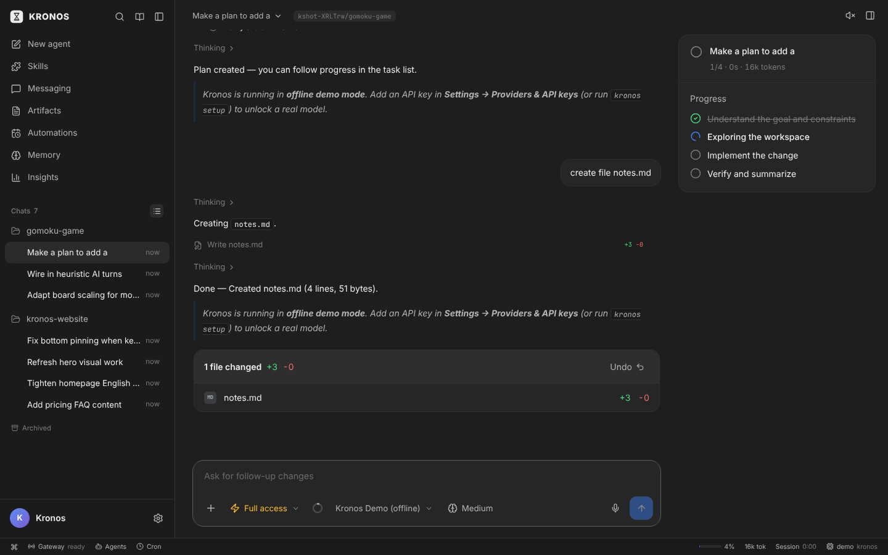
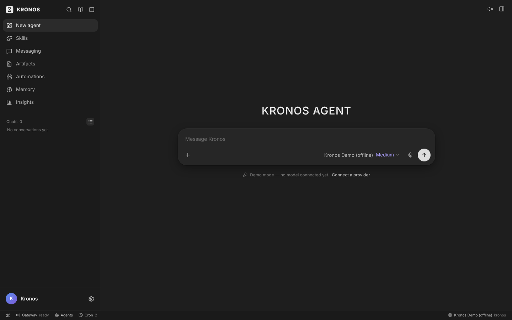
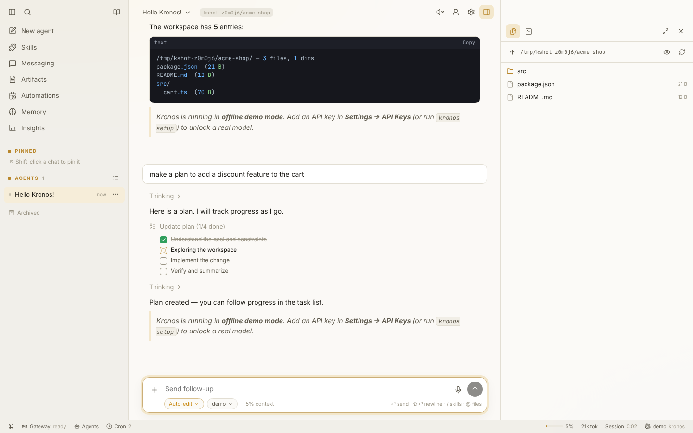
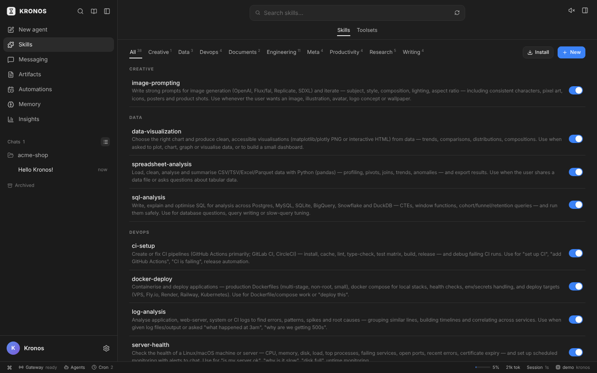
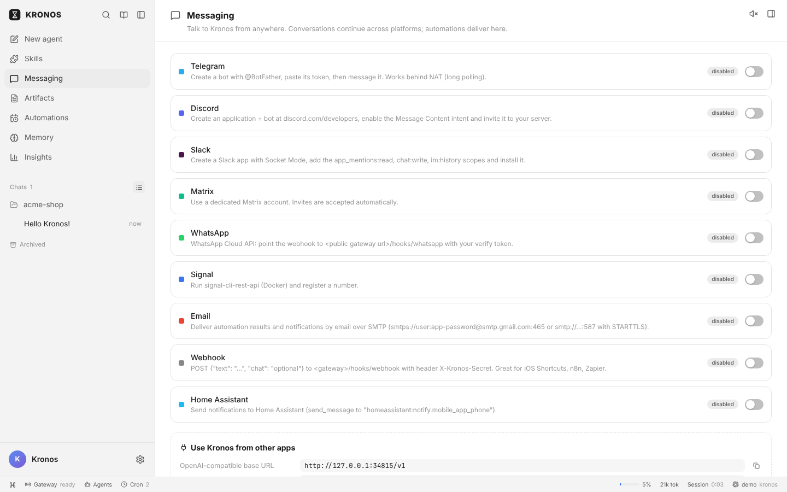
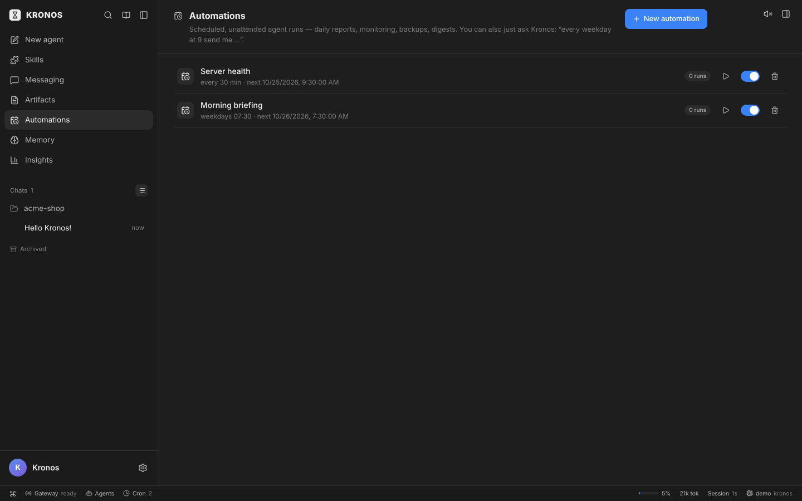
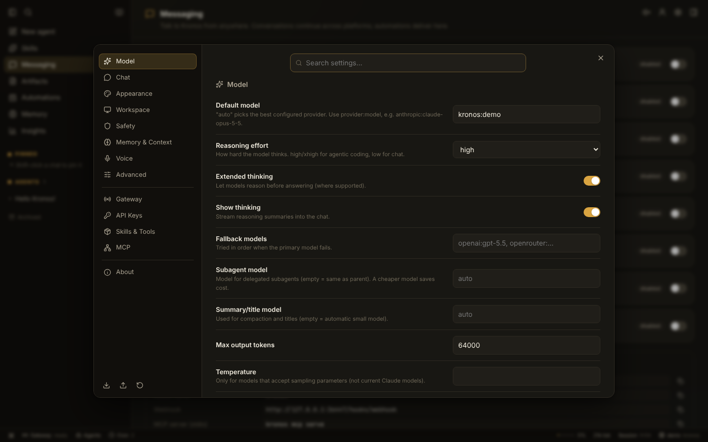
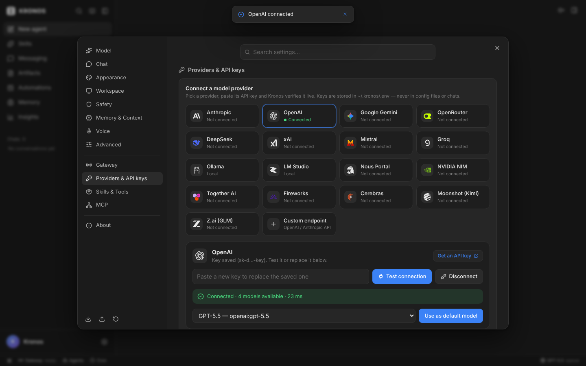

<div align="center">


# KRONOS AGENT

**One self-improving agent for your terminal, your desktop and every chat app you use.**
It codes, researches, automates and remembers — with any model, on your machine.

[Quick start](#quick-start) · [Features](#what-you-get) · [How it compares](docs/ANALYSIS.md) · [Architecture](docs/ARCHITECTURE.md) · [Configuration](docs/CONFIGURATION.md) · [Messaging](docs/MESSAGING.md) · [Security](docs/SECURITY.md) · [Performance](docs/PERFORMANCE.md) · [Research](docs/RESEARCH.md) · [Türkçe](#türkçe)



</div>

---

Kronos takes the best ideas from the agents people actually use — the coding loop and safety
model of **Claude Code / Codex**, the persistent memory, self-written skills and messaging
gateway of **Hermes Agent**, the always-on personal-assistant reach of **OpenClaw**, the
plug-in tool ecosystem of **MCP / Goose**, and the polish of a native desktop app — and puts them
behind one runtime, one memory and one set of skills that every surface shares.

Start a task in the desktop app, continue it from Telegram on your phone, let an automation
finish it at 3 a.m., and ask about it later from the terminal. It is the same agent.

## Quick start

**Requirements:** Node.js 20.19+ (22+ recommended — enables the built-in SQLite session store),
git. Python 3 is optional (better PTY terminal in the app).

```bash
# install (clones to ~/.kronos/app, builds, links `kronos` into ~/.local/bin)
curl -fsSL https://raw.githubusercontent.com/burkiuze/KronosAgent/main/scripts/install.sh | bash

kronos setup        # connect a model provider: paste an API key or point it at a local model
kronos              # chat in the terminal
kronos web          # the desktop UI in your browser
kronos gateway      # run 24/7: UI + messaging platforms + automations + API
```

From source:

```bash
git clone https://github.com/burkiuze/KronosAgent && cd KronosAgent
npm install && npm run build
node packages/cli/dist/bin.js        # or: npm link -w kronos-agent
```

Desktop app: `npm run build && npm run start -w @kronos/desktop` (packaged installers for macOS,
Windows and Linux are produced by the release workflow), or with Docker:

```bash
cp .env.example .env    # add keys + KRONOS_GATEWAY_TOKEN
docker compose up -d    # → http://localhost:7777/?token=<KRONOS_GATEWAY_TOKEN>
```

No API key yet? Kronos opens and asks you to connect a model provider first — the welcome
screen, the composer and the status bar all have a **Connect a provider** button that goes
straight to Settings → Providers & API keys. A message sent before that is accepted and kept in
the chat with a "No model provider connected" card under it; once you connect, **Answer now**
answers it right there — nothing is ever answered by a stand-in model. Local models (Ollama, LM Studio) need no key. The
offline demo model is only used when you pick it explicitly (`--model demo`), e.g. for tests.

## What you get

### An agent that does real work
- **35 built-in tools** in 19 toolsets: read/write/edit/multi-edit/apply-patch files, glob and
  grep, shell with background processes, sandboxed code execution, web search & fetch, a real
  browser (Playwright), HTTP/API calls, image generation and vision, text-to-speech, artifacts,
  messaging, planning (live todo list), clarifying questions, and **parallel subagents** that
  coordinate through a **shared team board** (claims, posts — no coordinator needed).
- **Verification built into the harness**: Kronos detects how your project checks itself (npm/pnpm
  /yarn/bun scripts, pytest/ruff/mypy, cargo, go, deno, Makefile, …), runs it with the `verify`
  tool, and if it changed files without verifying, it verifies before it reports back.
- **Codemaster** effort: maximum reasoning plus a principal-engineer workflow — plan with
  acceptance checks, propose → probe → compose for hard decisions, verify, independent review.
- **Streaming everything**: thinking summaries, text, tool input as it is generated, tool
  progress, diffs, todos and subagent activity — in the CLI, the app and chat platforms.
- **Parallel-safe tool execution**, tiered context management (old tool outputs cleared first,
  then older turns summarised and archived — never lost), a syntax check right after every edit,
  retries with backoff and a **fallback chain** across providers.

### Any model, no lock-in
Anthropic (Claude Opus 5.5 by default, with prompt caching, adaptive thinking and server-side
fallbacks), OpenAI, Google Gemini, OpenRouter, Groq, DeepSeek, Mistral, xAI, NVIDIA NIM, Nous
Portal, Together, Fireworks, Cerebras, Moonshot, Z.ai, **Ollama** and **LM Studio** locally, and
any OpenAI-compatible endpoint as a custom provider. Switch models mid-conversation; use a
cheaper model for subagents.

**Built to get good work out of small, old and free models too.** The harness absorbs what weaker
models get wrong: broken tool-call JSON is repaired; calls written as text in a model's own format
(Hermes/Qwen `<tool_call>`, Llama `<function=…>`, Mistral `[TOOL_CALLS]`, XML, fenced JSON) are
recognised; `bash`, `str_replace`, `file_path` and friends map onto the right tools and arguments;
models without function calling get a text tool protocol automatically; small context windows
get **lean mode** (core tools, compact prompt — ~70% less fixed context); `<think>` blocks are
kept out of answers; replies that only announce an action get a nudge to actually do it; and
every failed call comes back with the expected arguments and an example.

### It remembers and it improves
- **Memory**: a curated `MEMORY.md` (what the agent learned) and `USER.md` (who you are), with
  size budgets so they stay sharp, plus **full-text search over every past session**.
- **Skills** — procedural memory in the open `SKILL.md` format (compatible with Anthropic Agent
  Skills, Claude Code and Hermes skills). **38 bundled skills** (code review, debugging, deep
  research, PDF tools, spreadsheet analysis, release notes, daily briefing, Docker deploy, …),
  install more from any git repo, and Kronos **writes and patches its own skills** after it
  solves something hard. Only names and descriptions sit in context; bodies load on demand.
  Self-improvement is **governed**: an admission check (reusable, no secrets or task-specific
  values, no duplicates), a per-session edit budget, version history with rollback, and pruning
  of skills that stop helping.
- **`kronos eval`**: run a suite several times per model × effort configuration in isolated
  runtimes and get pass rate ± spread, tokens, cost, time and tool calls — measure before you
  trust a change.
- **Personas & profiles**: `SOUL.md` personality, 7 built-in styles, and isolated profiles
  (work / personal / family bot) each with their own memory, skills, sessions and keys.

### Everywhere you are
- **Terminal**: a fast REPL with streaming markdown, diffs, ~40 slash commands, `@file`
  mentions, `!shell`, multi-line input, queued follow-ups, Ctrl-C to interrupt.
- **Desktop app** (Electron) and **web UI**: sessions with pins/projects/archive, live tool cards,
  permission and question cards, files panel with editor, real PTY terminal, command palette,
  9 themes × light/dark (default: neutral Graphite), English UI (Kronos replies in your language), voice input/output,
  insights dashboard. Every turn ends with a "N files changed · Undo" summary and long tasks
  get a live Progress checklist beside the chat.
- **Effort levels & Codemaster**: Low, Medium (recommended), High, Extra high, Maximum — and
  **Codemaster**: max effort plus a plan → parallel exploration → tests → independent-review workflow.
- **Connect any provider from Settings**: pick a provider (with its logo), paste the key — it is
  verified live before it is saved — then choose the default model.
- **Messaging**: Telegram, Discord, Slack, WhatsApp, Signal, Matrix, webhooks, Home Assistant —
  with pairing codes for new users, in-chat approvals (`/approve`, `/deny`), `/model`, `/mode`,
  `/undo`, `/retry`, voice-memo transcription and per-platform profiles.
- **Automations**: schedule anything in plain language ("every weekday at 7:30"), deliver the
  result to any chat, see run history.
- **APIs**: an **OpenAI-compatible endpoint** (`/v1/chat/completions`, model `kronos`) so any
  app can use Kronos as a model, and an **MCP server** (`kronos mcp serve`) so Claude Desktop,
  Cursor and others can call it as a tool. Kronos is also an MCP **client** (stdio + HTTP).

### Safe by default
Permission modes (**Ask**, **Auto-edit**, **YOLO**, **Plan**), allow/deny rules such as
`shell(git *)`, dangerous-command detection that always asks, protected paths, secret redaction,
**file checkpoints with undo/retry**, lifecycle **hooks** (pre/post tool, prompt submit, session
start, stop), Docker or SSH terminal backends, a loopback-only gateway with token auth, and
pairing/allow-lists for chat users. Details in [docs/SECURITY.md](docs/SECURITY.md).

### Bring your history with you
`kronos import hermes|openclaw|claude|codex|cursor` copies memories, skills, instructions and
MCP servers from other agents. Project instruction files are picked up automatically:
`KRONOS.md`, `AGENTS.md`, `CLAUDE.md`, `GEMINI.md`, `.cursorrules`, `.windsurfrules`,
`.github/copilot-instructions.md`.

## A tour

| | |
|---|---|
|  |  |
|  |  |
|  |  |
|  | |

## Everyday commands

```bash
kronos "fix the failing tests"               # start an interactive session with a prompt
kronos run "summarise CHANGELOG.md" --json    # one-shot, scriptable
git diff | kronos run "review this diff"     # pipe anything in
kronos -m sonnet --plan                      # pick a model and start in plan mode
kronos -c                                    # continue the last CLI session

kronos model list | set openrouter:qwen/qwen3-coder
kronos keys set ANTHROPIC_API_KEY
kronos skills list | install <git-url> | create | history <name> | rollback <name> | prune
kronos eval examples/evals/smoke.yaml --repeats 3 --model sonnet,opus   # measure, with spread
kronos cron add "every monday at 9am" "Draft the weekly status report" --deliver telegram:<chat>
kronos mcp add github -- npx -y @modelcontextprotocol/server-github
kronos profile create work && kronos -p work
kronos doctor                                 # health check of keys, tools and services
```

In the REPL: `/help`, `/model`, `/mode`, `/plan`, `/yolo`, `/effort`, `/skills`, `/memory`,
`/remember`, `/compact`, `/context`, `/undo`, `/retry`, `/cost`, `/sessions`, `/resume`,
`/export`, `/agents`, `/cron`, `/review`, `/init` and more; any skill or custom command is also
a slash command.

## Project layout

```
packages/core      @kronos/core     agent loop, providers, tools, memory, skills, sessions, cron, MCP
packages/gateway   @kronos/gateway  HTTP/WebSocket API, PTY terminal, OpenAI API, messaging adapters
packages/cli       kronos-agent     the `kronos` command: REPL, subcommands, setup, importers
apps/web           @kronos/web      React UI served by the gateway
apps/desktop       @kronos/desktop  Electron shell: embedded gateway, tray, shortcuts, updates
skills/                             bundled skills (SKILL.md)
docs/                               analysis, architecture, configuration, messaging, security, performance, research
```

```bash
npm run build        # packages + web UI
npm test             # unit + integration tests (vitest)
npm run test:e2e     # drives the real UI in Chromium (needs playwright)
npm run bench        # CPU / memory of the UI and gateway (see docs/PERFORMANCE.md)
npm run typecheck
```

See [CONTRIBUTING.md](CONTRIBUTING.md) for development notes.

## License

[Apache-2.0](LICENSE)

---

## Türkçe

**KRONOS AGENT**, terminalinizde, masaüstünüzde ve kullandığınız her sohbet uygulamasında
çalışan, kendini geliştiren tek bir yapay zekâ ajanıdır. Kod yazar, araştırır, otomasyon kurar
ve hatırlar — istediğiniz modelle, kendi bilgisayarınızda.

En çok kullanılan ajanların en iyi fikirlerini tek bir çatı altında toplar: **Claude Code /
Codex**'in kodlama döngüsü ve güvenlik modeli, **Hermes Agent**'ın kalıcı hafızası, kendi
yazdığı yetenekleri (skills) ve mesajlaşma geçidi, **OpenClaw**'ın her an ulaşılabilen kişisel
asistan yapısı, **MCP / Goose** eklenti ekosistemi ve yerel bir masaüstü uygulamasının cilası.
Tüm arayüzler aynı çalışma zamanını, aynı hafızayı ve aynı yetenekleri paylaşır: bir işe
masaüstünde başlayıp telefonunuzdan Telegram ile devam edebilir, gece bir otomasyonun
bitirmesini sağlayabilir, sonra terminalden sorabilirsiniz.

### Hızlı başlangıç

```bash
curl -fsSL https://raw.githubusercontent.com/burkiuze/KronosAgent/main/scripts/install.sh | bash
kronos setup     # model sağlayıcısı bağlayın: API anahtarı girin ya da yerel model seçin
kronos           # terminalde sohbet
kronos web       # masaüstü arayüzü tarayıcıda
kronos gateway   # 7/24 çalıştırma: arayüz + mesajlaşma + otomasyonlar + API
```

Gereksinim: Node.js 20.19+ (22+ önerilir) ve git. İlk açılışta Kronos önce bir model
sağlayıcısı bağlamanızı ister: karşılama ekranındaki **Connect a provider** düğmesi doğrudan
Ayarlar → Providers & API keys bölümüne götürür. Bağlanmadan yazılan mesaj kabul edilir, sohbette
altında bir uyarı ve aynı düğme çıkar; bağlandıktan sonra **Answer now** ile yanıtlanır (demo
bir modelle asla yanıtlanmaz). Arayüz İngilizcedir; Kronos ise sana senin dilinde yanıt verir.

### Öne çıkanlar

- **35 yerleşik araç**: dosya okuma/yazma/düzenleme ve yama, glob/grep, arka plan süreçli
  kabuk, kod çalıştırma, web arama ve sayfa okuma, gerçek tarayıcı, HTTP/API çağrıları, görsel
  üretme ve görme, seslendirme, artifact'ler, mesaj gönderme, canlı görev listesi, soru sorma ve
  ortak bir **ekip panosu** üzerinden koordine olan **paralel alt ajanlar**.
- **Doğrulama sistemin parçası**: Kronos projenin kendi test/tip/lint/build komutlarını bulur,
  `verify` aracıyla çalıştırır; dosya değiştirip doğrulamadıysa bitirmeden önce doğrular.
- **Yönetilen öz-gelişim**: ajanın yazdığı yetenekler kabul kontrolünden geçer, oturum başına
  düzenleme bütçesi, sürüm geçmişi ve geri alma vardır; işe yaramayan yetenekler ayıklanır.
  `kronos eval` ile değişiklikleri tekrar tekrar ölçün (başarı oranı ± sapma, token, maliyet).
- **Her model**: Anthropic (varsayılan Claude Opus 5.5), OpenAI, Gemini, OpenRouter, Groq,
  DeepSeek, Mistral, xAI, NVIDIA, Nous, Together, Fireworks, Cerebras, Moonshot, Z.ai, yerelde
  **Ollama** ve **LM Studio**, ayrıca her OpenAI uyumlu uç nokta. Yedek model zinciri desteklenir.
- **Hafıza ve öğrenme**: `MEMORY.md` + `USER.md`, tüm geçmiş oturumlarda tam metin arama,
  **38 hazır yetenek**, git'ten yetenek kurma ve ajanın zor bir işi çözdükten sonra **kendi
  yeteneğini yazması**. Kişilik (`SOUL.md`) ve birbirinden yalıtılmış profiller.
- **Her yerde**: terminal (REPL), Electron masaüstü uygulaması, web arayüzü; Telegram, Discord,
  Slack, WhatsApp, Signal, Matrix, webhook ve Home Assistant; doğal dille zamanlanan
  otomasyonlar ("her hafta içi 7:30'da"); OpenAI uyumlu API ve MCP sunucusu/istemcisi.
- **Güvenli varsayılanlar**: Sor / Otomatik düzenle / YOLO / Plan izin modları, izin/engelleme
  kuralları, tehlikeli komut tespiti, korunan yollar, gizli bilgi maskeleme, dosya kontrol
  noktaları ile geri alma, kancalar (hooks), Docker/SSH terminali, yalnızca yerel ağda ve token
  ile korunan geçit, sohbet kullanıcıları için eşleştirme kodları.
- **Taşıma**: `kronos import hermes|openclaw|claude|codex|cursor` ile diğer ajanlardaki hafıza,
  yetenek ve MCP ayarlarını içe aktarın.

Rakip ajanların ayrıntılı analizi ve özellik karşılaştırması için
[docs/ANALYSIS.md](docs/ANALYSIS.md) belgesine bakın.
