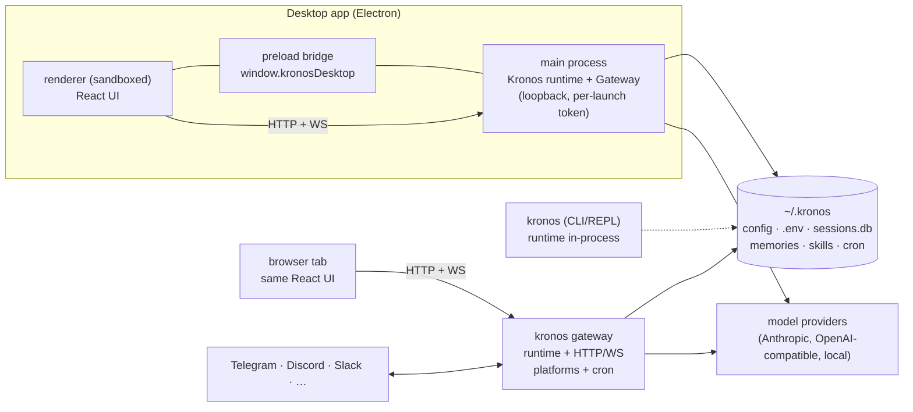
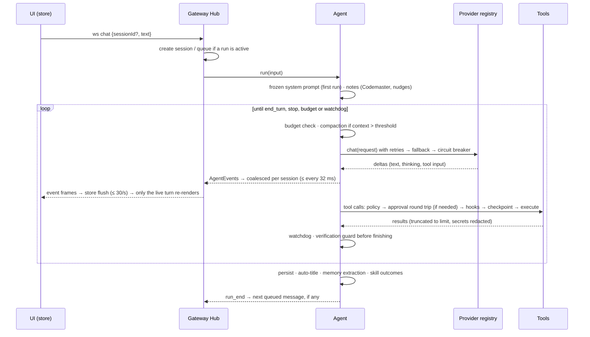

# Architecture

Kronos is a TypeScript monorepo (npm workspaces, ESM, Node ≥ 20.19). Everything that makes the
agent *the agent* lives in `@kronos/core`; every surface is a thin client of one `Kronos`
runtime object.

```
                 ┌──────────────────────── surfaces ─────────────────────────┐
  terminal ──▶ kronos-agent (CLI/REPL)                                       │
  browser  ──▶ @kronos/web  ──HTTP/WS──┐                                     │
  desktop  ──▶ @kronos/desktop (Electron, embeds the gateway)                │
  chat apps ─▶ platform adapters ──────┤                                     │
  other apps ▶ /v1/chat/completions ───┤                                     │
  MCP clients ▶ kronos mcp serve ──────┤                                     │
  cron ───────────────────────────────┐│                                     │
                                      ▼▼                                     │
                      @kronos/gateway (Router, Hub, Terminal, Platforms)     │
                                      │                                      │
                                      ▼                                      │
 ┌──────────────────────────── @kronos/core: Kronos runtime ─────────────────┴──┐
 │ config + profiles · ProviderRegistry · ToolRegistry · PermissionPolicy · Hooks │
 │ Agent loop · Memory · SkillRegistry · SessionStore · Artifacts · CronScheduler │
 │ McpManager · TerminalBackend (local/docker/ssh) · BrowserManager · media       │
 └────────────────────────────────────────────────────────────────────────────────┘
```

## Packages

| Package | Responsibility |
|---|---|
| `packages/core` (`@kronos/core`) | Types, config/profiles, providers, the agent loop, tools, safety, memory, skills, sessions, artifacts, cron, MCP client/server, media, messaging senders, the `Kronos` runtime. No HTTP server, no UI. |
| `packages/gateway` (`@kronos/gateway`) | `Gateway.start(rt)` — HTTP router (`/api/*`), WebSocket streaming (`/ws`), PTY terminal (`/ws/terminal`), OpenAI-compatible API (`/v1`), webhooks (`/hooks/*`), static UI, the `Hub` that runs/queues chats, and the messaging `PlatformManager`. |
| `packages/cli` (`kronos-agent`) | The `kronos` binary: REPL with streaming markdown renderer, subcommands, setup wizard, importers. |
| `apps/web` (`@kronos/web`) | React 19 + Vite UI. A tiny external store (`useSyncExternalStore`), a reconnecting WebSocket, i18n (en/tr), 9 themes. Served by the gateway. |
| `apps/desktop` (`@kronos/desktop`) | Electron shell: embeds the runtime + gateway on loopback with a per-launch token (or attaches to a running gateway), tray, menus, global shortcut, notifications, deep links, auto-update. |

## The runtime (`packages/core/src/runtime.ts`)

`Kronos.create({ home, profile, cwd, overrides })` loads config, creates the profile directory,
then wires up: `ProviderRegistry`, `ToolRegistry` (built-ins + MCP), `MemoryStore`,
`SkillRegistry`, `SessionStore` (SQLite via `node:sqlite` with FTS5, JSON fallback),
`ArtifactStore`, `CronScheduler`, `McpManager`, terminal backend and hooks. It exposes:

- `createSession()`, `agent(sessionId)` (live, cached `Agent` per session), `runHeadless()` (cron,
  API, MCP server), `deleteSession()`
- `expandInput()` — `/skill` and custom `/command $ARGUMENTS` expansion and `@file` mentions
- `updateConfig()` / `setConfig()` (writes YAML, hot-reloads), `soul` / `setSoul()`
- `sendMessage()` — delivery through a running platform adapter or a stateless sender
- `events` — a typed event bus (agent events, session updates, config changes, cron runs,
  artifacts) that the gateway fans out to WebSocket clients
- `track(promise)` + `close()` — background work (titles, memory extraction) finishes before
  shutdown

## The agent loop (`agent/agent.ts`)

```
user input ─▶ userPromptSubmit hooks ─▶ append to history
   ▲                                         │
   │                          ┌──────────────▼──────────────┐
   │                          │ provider.stream(request)    │  thinking / text / tool_use
   │                          │  (retries, fallback chain)  │  deltas → AgentEvents
   │                          └──────────────┬──────────────┘
   │                                         │ tool_use blocks
   │           ┌─────────────────────────────▼─────────────────────────────┐
   │           │ for each call: permission policy (mode, allow/deny rules, │
   │           │ dangerous-command check, protected paths) → ask the UI if │
   │           │ needed → preToolUse hooks → checkpoint files → execute    │
   │           │ (parallel-safe tools run concurrently) → postToolUse hooks │
   │           └─────────────────────────────┬─────────────────────────────┘
   │                                         │ tool_result blocks
   └──────────── loop until end_turn / max iterations / interrupt ◀────────┘
                files changed but never verified? → one verification turn first
                then: stop hooks, auto-title, memory & skill nudges, skill outcomes, usage log
```

Key properties:

- **Append-only history** and a **system prompt frozen per session** (identity, persona,
  environment, project context files, memory snapshot, skill index, toolset notes). Mid-session
  changes are delivered as notes on the next user turn, so provider prompt caches stay valid.
- **Streaming events** (`AgentEvent`): `run_start`, `turn_start`, `thinking_delta`,
  `text_delta`, `tool_call_start`, `tool_call_delta` (tool input as it is generated),
  `tool_call`, `tool_progress`, `tool_result`, `permission_request` / `permission_resolved`,
  `clarify_request` / `clarify_resolved`, `message`, `usage`, `compaction`, `todos`, `subagent`,
  `artifact`, `notice`, `title`, `run_end`.
- **Context management** when the context passes `agent.compaction.threshold`, in three tiers:
  1. *Clear old tool outputs* — the bodies of tool results older than the `keepToolResults` most
     recent become a one-line stub (calls, order and errors stay). Cheap, no model call; the stored
     session keeps the full output. Often enough on its own in tool-heavy runs.
  2. *Summarise* — everything before the last `keepRecentTurns` user turns is summarised by the
     summary model (fewer turns are kept when they alone would fill the window). Long histories
     are summarised in ~100k-character chunks that fold into a running summary. The replaced
     messages move to the session **archive**: still searchable (`session_search`) and shown in
     the app under "Show earlier messages".
  3. *Trim* — if the summary call fails, the recent turns are kept and the rest is archived with
     a note, so the user's task continues instead of failing.
- **Weak-model harness** (`providers/toolcalls.ts`) — good work from small, old and free models:
  - tool-call arguments are parsed with JSON repair (trailing commas, single quotes, unquoted
    keys, Python literals, raw newlines, truncation, double encoding);
  - calls a model writes into its text are recognised: Hermes/Qwen `<tool_call>`, Qwen3-Coder and
    Llama `<function=…>`, Llama `<|python_tag|>`, Mistral `[TOOL_CALLS]`, `<invoke>`, Cline-style
    `<read_file>…</read_file>`, fenced or bare JSON. Tagged formats always count; ambiguous ones
    only in the text protocol or when the reply is little more than the call, so an example in a
    real answer never fires a tool;
  - near-miss tool names (`bash`, `str_replace`, `functions.read_file`, typos) and argument names
    (`file_path`, `cmd`, `old_str`, `oldString` …) map onto the real ones; failed calls return the
    expected arguments and an example call;
  - **text tool protocol** (`model.toolMode`): tools described in the system prompt, calls and
    results replayed as `<tool_call>` / `<tool_result>` text. `auto` switches a model to it when
    its provider rejects the `tools` parameter;
  - **lean mode** (`agent.lean`, auto for windows ≤ 32k): 14 core tools, first-sentence
    descriptions and an 8-rule prompt — ~2.4k instead of ~9k fixed tokens;
  - `<think>…</think>` in the content stream (R1, QwQ and other local reasoning models) is routed
    to thinking, never into the answer or history;
  - an empty reply, or one that announces an action without calling a tool, gets one short nudge
    to continue (a real final answer is never blocked).
- **Syntax check after edits** (`agent.editDiagnostics`): files written by `write_file`,
  `edit_file`, `multi_edit` or `apply_patch` are parsed at once (TS/JS via the workspace's or
  Kronos's TypeScript parser, else `node --check`; JSON, YAML, Python `ast`), and parse errors with
  the offending lines are appended to that tool result — the agent fixes them while the change is
  still in view instead of meeting them later as a confusing build or test failure.
- **Interrupts** keep history valid: pending tool calls receive synthetic "interrupted" results.
- **Checkpoints**: files are snapshotted before the first write in a turn → `undo` restores
  them and truncates history; `retry` re-runs the last prompt.
- **Subagents** (`delegate`): each gets a fresh context, a typed role (general, explorer,
  researcher, coder, reviewer, planner, or a markdown-defined agent), its own tool subset and an
  optional cheaper model; they run concurrently up to `agent.subagents.maxConcurrent` and nest to
  `maxDepth`. Two or more subagents form a **team** with a shared board (`agent/board.ts`,
  `team_board` tool): no coordinator — members read it, post what others need, claim extra work
  items (claiming someone else's fails) and mark them done; the parent gets the board with the
  reports and the UI shows posts live.
- **Verification** is part of the harness: the workspace's own checks are detected
  (`agent/checks.ts`) and listed in the prompt, the `verify` tool runs them and returns PASS/FAIL
  with failing lines first, and a run that changed files without verifying afterwards gets one
  verification turn before it may finish (`agent.verifyBeforeFinish`).
- **Codemaster** (effort `codemaster`): maximum effort plus a workflow note — gather information,
  plan with acceptance checks, Propose–Probe–Compose for non-obvious decisions, verify, independent
  review, capture what is reusable. Its on/off state is restored from history.
- **Idle agents are capped** (8, LRU); everything they hold is persisted, so an evicted session
  rebuilds its agent on the next message.
- **Watchdog** (`agent/watchdog.ts`): the same call failing with the same input 3 times gets a
  plain note to change approach; 6 times ends the run (`stalled`). An identical read repeated 4
  times in one run is flagged too. Commands, checks and polling are exempt.
- **Budget**: `agent.budget` caps tokens, cost or minutes per run; reaching it ends the run cleanly
  (`budget`) with the last answer kept, and "continue" resumes.
- **Unchanged reads**: re-reading the same range of a file that has not changed, while the earlier
  output is still in context, returns a pointer to it instead of the whole file. Compaction and
  undo invalidate this (the earlier output is gone); any file write clears it.

## Providers (`providers/`)

- `anthropic.ts` — official SDK (beta messages stream): adaptive thinking with summarised
  display, `effort`, eager tool-input streaming, automatic prompt caching, server-side refusal
  fallbacks and thinking-block binding controls when available, no sampling parameters for
  models that reject them, graceful retry without optional betas.
- `openai.ts` — fetch + SSE for every OpenAI-compatible API (OpenAI, OpenRouter, Gemini, Groq,
  DeepSeek, Mistral, xAI, NVIDIA, Nous, Together, Fireworks, Cerebras, Moonshot, Z.ai, Ollama,
  LM Studio, custom). Extracts inline `<tool_call>{…}</tool_call>` emitted by Hermes-style models.
- `demo.ts` — deterministic offline model that exercises real tools (tests and explicit
  `--model demo` runs only — never a silent fallback).
- `registry.ts` — `provider:model` references, aliases (`opus`, `sonnet`, `gpt`, `gemini`,
  `hermes`, `local`, …), `auto` selection by configured keys, retries with backoff for
  retryable errors and a fallback chain (`model.fallbacks`). A **circuit breaker** skips a
  provider for 60 s after 3 failed requests in a row (outages only, not rejected requests) when
  the chain has an alternative. When an attempt is retried or falls back after it already
  streamed output, a `restart` signal makes clients discard the partial text first.
  `readiness()` is checked before any run. With no provider connected, an interactive chat keeps
  the message (flagged `meta.unanswered: 'no_provider'`) and emits a `notice` with
  `code: 'no_provider'`; the UI shows a "Connect a provider" card under it, and
  `Agent.answerHeld()` (`POST /api/sessions/:id/answer`) answers it once a provider is connected.
  Headless runs, REST `/api/chat` and `/v1/chat/completions` are refused with `NotConnectedError`
  (HTTP 409) before a session is created. A chat pinned to the demo model moves to the
  configured provider once one is connected.
- `catalog.ts` — model metadata: context window, output limit, tool/vision support, pricing
  (for cost tracking).

## Tools (`tools/`)

35 built-in tools grouped into toolsets that can be toggled per profile:

| Toolset | Tools |
|---|---|
| files | `read_file`, `write_file`, `edit_file`, `multi_edit`, `apply_patch`, `list_dir`, `glob`, `grep`, `fs` |
| shell | `shell`, `process` (background processes), `verify` (the project's own checks) |
| code | `execute_code` (Python / JavaScript / Bash) |
| web · http · browser | `web_search`, `web_fetch`, `http_request`, `browser` |
| memory · sessions | `memory`, `session_search` |
| todo · clarify · core | `todo_write`, `ask_user`, `exit_plan_mode` |
| delegate · skills | `delegate`, `team_board` (team members only), `skills_list`, `skill_view`, `skill_manage` |
| cron | `cron_create`, `cron_list`, `cron_update` |
| image · vision · voice | `generate_image`, `view_image`, `text_to_speech` |
| artifacts · messaging | `artifact_create`, `send_message` |
| mcp | every tool of every connected MCP server, as `mcp__<server>__<tool>` |

Each `ToolDefinition` declares a JSON schema, a `risk` level (`read`, `write`, `execute`, `network`,
`external`), whether it is parallel-safe, a human summary for UIs, and `execute(input, ctx)`.
Tool output is truncated to `agent.toolOutputLimit` with a pointer to the full content.

## Safety (`safety/`)

`PermissionPolicy.check(tool, input)` combines: the session **mode** (`ask` asks for writes and
execution, `auto-edit` auto-approves file edits in the workspace, `yolo` approves everything
except what must always ask, `plan` refuses writes until `exit_plan_mode` is approved), **deny
rules** (always win), **allow rules** (`shell(npm test*)`, `write_file(src/**)`, `mcp__github__*`),
**dangerous command detection** (`rm -rf /`, `mkfs`, fork bombs, `curl … | sh`, force pushes,
disk writes…) per `safety.dangerousCommands`, **protected paths** and `workspaceOnly`.
Approvals can be "once", "always for this session" or "always" (persisted as an allow rule).
Secrets in tool output are redacted when `safety.redactSecrets` is on.

## Memory, skills, sessions

- **Memory** (`memory/store.ts`): `memories/MEMORY.md` and `memories/USER.md`, entries separated
  by `§`, each file with a character budget. The agent edits them with the `memory` tool
  (add / patch / remove / search / view). A snapshot is taken at session start (frozen prompt); the
  agent is nudged every `agent.nudges.memoryEvery` turns to save durable facts.
- **Skills** (`skills/registry.ts`): directories with `SKILL.md` from (in priority order)
  project `.kronos/skills`, user `~/.kronos/skills`, extra dirs, Claude-compatible dirs and the
  bundled `skills/`. Only names + descriptions go into the prompt; `skill_view` loads bodies and
  supporting files; `skill_manage` creates, patches, updates, deletes and installs from git.
  BM25 search ranks skills for a task. After many tool calls in a turn the agent is nudged to
  capture the procedure as a skill.
- **Skill governance** — self-improvement that cannot run away: skills the agent writes pass an
  **admission gate** (bounded size, a real "when to use" description, no secrets, no task-specific
  values such as temp paths or run ids, not a duplicate); each session has an **edit budget**
  (`skills.editBudget`); every change **snapshots the previous version** (`.history/`, 20 kept),
  `rollback` restores any version (deleted skills included) and a rolled-back change is
  **not admitted again**; run **outcomes** per skill are recorded and stale or failing
  agent-written skills are offered for **pruning** (`kronos skills prune`, Skills page).
- **Sessions** (`sessions/store.ts`): sessions, messages (JSON parts), usage records and an FTS5
  index over message text. Child sessions record subagent runs. Without SQLite, an equivalent
  JSON-file store is used.

## Gateway (`packages/gateway`)

- **REST** (`api.ts`): status, doctor, config (get/patch/reset/export/import), keys (`.env`),
  providers/models, sessions (CRUD, undo, compact, fork, export, stop), search, chat, skills,
  toolsets, commands, agents, artifacts, files (list/read/write/upload), memory, soul, profiles,
  cron, MCP, platforms + pairing, usage/insights, voice, git.
- **WebSocket** `/ws`: clients `subscribe` to sessions and send `chat`, `stop`, `unqueue`,
  `permission`, `clarify`, `set_mode`, `set_model`; the server streams `agent` events, session
  updates, config changes, cron and platform status. The `Hub` serialises runs per session and
  queues follow-ups. Token deltas are **coalesced** per session (merged and sent at most every
  32 ms, flushed before any other event) and broadcasts are encoded once for all clients.
- **Terminal** `/ws/terminal`: a real PTY via a small Python `pty` bridge (resize over a side
  channel), falling back to `script` or pipes.
- **OpenAI-compatible** `/v1/models`, `/v1/chat/completions` (streaming and non-streaming): the
  last user message runs through a full Kronos agent turn with tools, memory and skills.
- **Auth**: a token (Bearer, `?token=`, or cookie) — required automatically when binding to a
  non-loopback address; CORS allow-list; webhooks verify their own secrets.
- **Platforms** (`platforms/`): Telegram (long polling), Discord (gateway WebSocket), Slack
  (Socket Mode), Matrix (`/sync`), Signal (signal-cli REST), WhatsApp (Cloud API webhook),
  generic webhook. Each maps a chat to a Kronos session, supports pairing, approvals, chat
  commands and voice-memo transcription, and chunks/format messages per platform. Outbound-only
  delivery also covers Home Assistant and email (SMTP).

## Data layout

```
~/.kronos/                     (KRONOS_HOME; the "default" profile)
  config.yaml                  user config (project overrides: <repo>/.kronos/config.yaml)
  .env                         API keys and secrets (never shown back in full)
  SOUL.md                      persona
  KRONOS.md                    global instructions loaded into every session
  memories/MEMORY.md, USER.md  long-term memory
  skills/                      user + agent-created skills
  agents/                      custom subagent definitions (*.md)
  commands/                    custom slash commands (*.md)
  sessions.db                  SQLite sessions, messages, usage, FTS index
  artifacts/                   artifact index + files
  cron/                        jobs.json + run history
  checkpoints/                 file snapshots for undo
  cache/, logs/, outputs/
  profiles/<name>/…            same layout per extra profile
  active_profile
```

## Process model



- **One runtime per process.** The CLI embeds it for a session; `kronos gateway` and the desktop
  app run it long-lived with the HTTP/WebSocket server, messaging platforms and the cron
  scheduler. Every UI (desktop renderer, browser tab) is a thin client of a gateway.
- **The desktop renderer is sandboxed** (context isolation, no Node). It talks to the embedded
  gateway over loopback with a per-launch token; the preload exposes only notifications, badges,
  folder pickers and menu/tray commands. A window hidden to the tray is destroyed after 10 minutes
  and rebuilt on demand; messages meant for it are delivered once the new page has loaded.
- **Child processes** are spawned only for work: shell commands and background processes, code
  execution, the PTY bridge, MCP stdio servers, Playwright's browser (loaded on first use).

## Lifecycle of a message



Everything above the network boundary is persisted as it happens (append-only messages, usage
rows), so a crash or restart loses at most the turn in flight; agents are rebuilt from history.

## Concurrency model

- **Single-threaded Node event loop** per process; all I/O is asynchronous. CPU-heavy work
  (commands, code, browsers, MCP servers) runs in child processes.
- **One run per session at a time.** Follow-ups queue in the Hub (or interrupt, if asked). Any
  number of sessions run concurrently — chats, platform conversations and cron jobs.
- **Within a turn**, tool calls marked parallel-safe (reads, searches, fetches) run concurrently;
  the rest run in order. Subagents run concurrently up to `agent.subagents.maxConcurrent` and
  nest to `maxDepth`; teams coordinate through their board rather than through the parent.
- **Cron** runs due jobs up to `cron.maxConcurrent` at a time, each as a headless agent run.
- **Interactive pauses** (permission requests, clarifying questions) suspend only that agent; they
  time out after 30 minutes.

## Failure handling

| Failure | What happens |
|---|---|
| Provider overloaded / 5xx / network | Retries with backoff (honouring `Retry-After`) → fallback chain → circuit breaker; partial output from a failed attempt is discarded on clients (`restart`) |
| Request rejected (bad input, auth, missing model) | Not retried; a clear error; the breaker is not tripped |
| Optional API feature rejected | Retried once without optional betas; kept off only if that fixes it |
| Model output cut mid tool call | The truncated call is never run; the turn is retried with a larger output limit |
| Tool error | Returned to the model as a result; the watchdog steps in if it repeats |
| Agent stuck in a loop | Note after 3 identical failures, stop (`stalled`) after 6 |
| Run too long / too costly | `agent.budget` stops it cleanly (`budget`) |
| Context window filling up | Clear old tool outputs → summarise older turns (archived) → trim if the summary fails |
| Edit breaks a file's syntax | Parse error and offending line reported in the same tool result |
| User interrupt | Pending tool calls get synthetic "interrupted" results; history stays valid |
| Bad edit | Checkpoints → `undo` restores files and truncates history |
| Process restart / crash | Sessions, messages, todos, allow-rules and Codemaster state are on disk; agents rebuild |
| Bad self-modification | Skill admission gate, edit budget, versioned history, rollback |
| UI disconnect | The WebSocket reconnects; the UI reloads the session; runs continue server-side |

## Resource bounds

Everything that grows with use has a ceiling, so a Kronos that runs for weeks stays as light as
one that just started:

| What | Bound |
|---|---|
| Live agents in memory | 8 idle (LRU); running ones are never evicted |
| Context per session | compaction at 80 % of the window (configurable) |
| Tool output in context | `agent.toolOutputLimit` (40k chars); the rest goes to a file with a pointer |
| Streaming traffic | ≤ 1 frame per session every 32 ms (gateway), ≤ 30 renders/s (UI) |
| Markdown render cache | ~2 M characters, LRU |
| Team board | 400 posts, 2k chars each |
| Skill history | 20 versions per skill; edit budget per session |
| Hidden desktop window | renderer released after 10 minutes |
| Idle UI | no timers or animations running (enforced by an e2e check) |

Measurements and the reasoning behind each bound are in [PERFORMANCE.md](PERFORMANCE.md).

## Extension points

| Extend with | How |
|---|---|
| **Skills** | a folder with `SKILL.md` (open format) in `~/.kronos/skills`, `.kronos/skills` or any git repo (`kronos skills install`) |
| **Subagent types** | markdown files with frontmatter (`name`, `description`, `tools`, `model`) in `~/.kronos/agents` or `.kronos/agents` |
| **Slash commands** | markdown prompt templates in `~/.kronos/commands` |
| **Tools** | any MCP server (`kronos mcp add`), or a `ToolDefinition` registered on the runtime |
| **Hooks** | shell commands on `sessionStart`, `userPromptSubmit`, `preToolUse`, `postToolUse`, `stop` (block, add context, audit) |
| **Models** | any OpenAI-compatible endpoint as a custom provider; local servers (Ollama, LM Studio, vLLM, llama.cpp) |
| **Surfaces** | the REST/WS API, the OpenAI-compatible `/v1` API, the MCP server (`kronos mcp serve`), webhooks |

## Evaluation (`eval/runner.ts`)

`kronos eval suite.yaml` runs every case × repeat × (model, effort) configuration in a **fresh,
isolated runtime** (its own home: no memory, skills or sessions carry over) and a fresh workspace
built from the case's fixture files. Checks are typed: answer contains / regex, file exists /
contains, a shell command that must pass, a tool-call ceiling. The report gives pass rate with its
**standard deviation across repeats** (the same configuration varies a lot from run to run),
tokens, cost, time and tool calls per run; `--out` writes every run as JSON and
`--trajectories <dir>` writes each run's full message history (one JSONL per run, failed runs
marked) for inspection.
`examples/evals/smoke.yaml` is a starting point.

## Design map

How the pieces line up along the four dimensions agent surveys use to compare systems:

| Dimension | Kronos |
|---|---|
| **Autonomy** | agent loop with plans (`todo_write`), compaction, interrupts, checkpoints/undo; effort levels and Codemaster; cron automations that run unattended; verification enforced before finishing; watchdog and per-run budget so autonomy cannot run away |
| **Tool use** | 35 tools in toggleable toolsets + every MCP server; risk levels per tool; project checks detected and exposed through `verify`; actions-as-code (`execute_code`, `shell`) |
| **Collaboration** | typed subagents in parallel; teams coordinate through a shared board with claims; 15+ chat platforms; the OpenAI-compatible API and an MCP server for other agents |
| **Safety & governance** | permission modes, allow/deny rules, dangerous-command detection, protected paths, sandboxed backends, secret redaction; bounded, versioned and reversible self-modification (skill governance); evaluation with repeats before trusting a change |

The research behind the latest changes is summarised in [RESEARCH.md](RESEARCH.md); resource
use is covered in [PERFORMANCE.md](PERFORMANCE.md).

## Testing

- `npm test` — vitest: utilities, providers' message conversion, the full agent loop against the
  demo model (tools, permissions, plan mode, memory across sessions, subagents, interrupts,
  compaction, session search, cron), SMTP delivery, and the gateway (REST, WebSocket chat
  streaming, auth, OpenAI-compatible API, PTY terminal).
- `npm run test:e2e` — boots a gateway on a temp home and drives the real UI in Chromium with
  Playwright (chat, tool cards, plans, every page, settings, palette, files, terminal), failing on
  any browser error, plus an idle-CPU regression guard.
- Architecture tests (`packages/core/test/architecture.test.ts`): project-check detection, the
  verify tool and the verification guard, the team board (claims, posts, team prompts), skill
  admission / budget / history / rollback / pruning, and the eval runner.
- `npm run bench` — CPU and memory of the UI (idle and streaming) and the gateway.
